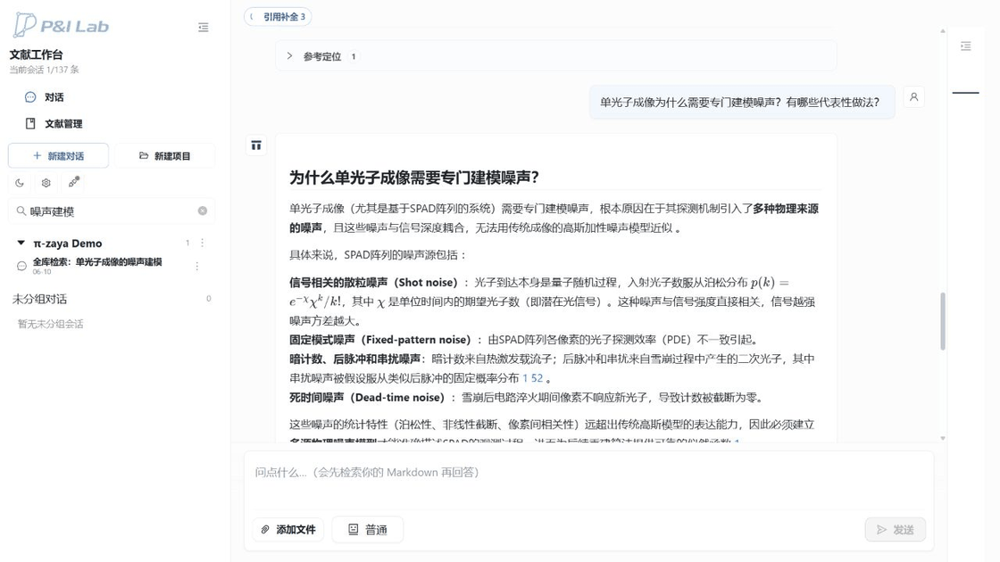
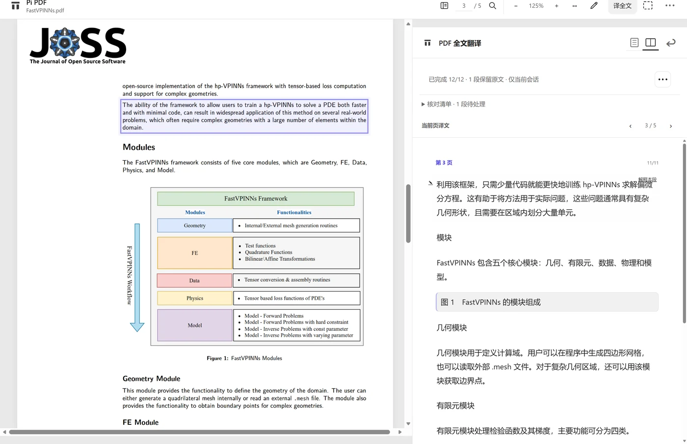

# Yanxi Pan · 潘彦茜

I build software and contribute to open source, with interests in **AI applications, numerical computing, and systems programming**.

My work spans tools for research and reading, floating-point correctness in SIMD libraries, and fixes in the PyTorch ecosystem.

[Website & writing](https://littlepyx.github.io/about/) · [Open-source contributions](#open-source-contributions) · [Selected projects](#selected-projects)

## Open-source contributions

Selected contributions incorporated upstream:

| Project | Contribution | Upstream |
| --- | --- | --- |
| **PyTorch** | Fixed an AOT/Dynamo circular import that could break a later `torch.compile` call. | [#204231](https://github.com/pytorch/pytorch/commit/62280d37c702b9f201a34209c67a0ad35a605798) |
| **PyTorch** | Added Dynamo support for the iterators used when copying an `OrderedDict`. | [#204199](https://github.com/pytorch/pytorch/commit/06365afc4fb969daa469facafd2dccc09c914dc2) |
| **Google Highway** | Added support for multiple template arguments in dynamic dispatch. | [#3548](https://github.com/google/highway/pull/3548) |
| **Google Highway** | Preserved signed-zero counts in VQSort's two-value partition and sorting networks. | [#3543](https://github.com/google/highway/pull/3543) · [#3544](https://github.com/google/highway/pull/3544) |
| **x86-simd-sort** | Fixed SIMD compare-exchange to preserve the counts of positive and negative zeros. | [#244](https://github.com/numpy/x86-simd-sort/pull/244) |

**NumPy — open pull requests:** [#33331](https://github.com/numpy/numpy/pull/33331) corrects the stream returned by `MT19937.jumped()`; [#33354](https://github.com/numpy/numpy/pull/33354) proposes skipping BLAS for short contiguous float64 `vecdot` inputs. These changes are not yet merged.

**XERJ Corpus Hub — corpus contribution:** [Pi Zaya was selected for the corpus](https://hub.xerj.org/contributors/LittlePyx), with a [commit](https://github.com/LittlePyx/Pi_zaya/commit/3b1a43e485bab3c73b4dd3dd8b5fddff3d3955cc) that links Noise2Noise conditions to supporting source passages.

## Selected projects

I develop and maintain three tools for finding, reading, and working with research papers.

### Pi Zaya · Literature retrieval and citation tracing

A research assistant for a local academic library, with cross-paper retrieval, evidence-grounded answers, and citations that lead back to source passages.

[Source code](https://github.com/LittlePyx/Pi_zaya) · [Windows releases](https://github.com/LittlePyx/Pi_zaya/releases) · [Project walkthrough](https://littlepyx.github.io/projects/pi-zaya/)

*Demo screenshots show a cited answer and the highlighted source passage.*

### Pi Research · Paper discovery and screening

Continuous paper discovery and personalized screening, with research maps and reading paths built from relevant papers.

[Source code](https://github.com/LittlePyx/pi-research) · [Public demo](https://pi-research-agent.qiudao-pika.chatgpt.site/demo) · [Project walkthrough](https://littlepyx.github.io/projects/pi-research/)

*The Today view uses public papers and sample recommendation data.*

### Pi Translator · Bilingual reading in Edge

An Edge extension for bilingual reading across webpages, Overleaf, and PDFs, with research notes, terminology, and user-configured AI providers.

[Source code](https://github.com/LittlePyx/Pi-translator) · [Edge Add-ons](https://microsoftedge.microsoft.com/addons/detail/pi-translator/edfkcddhenkhdkedhnmcebmmfacabcjf) · [Project walkthrough](https://littlepyx.github.io/projects/pi-translator/)

*PDF preview with sample translation output. The source paper is [FastVPINNs](https://doi.org/10.21105/joss.06764) ([CC BY 4.0](https://creativecommons.org/licenses/by/4.0/)).*

---

Currently exploring numerical software, framework internals, and performance engineering while continuing to improve my applications.
